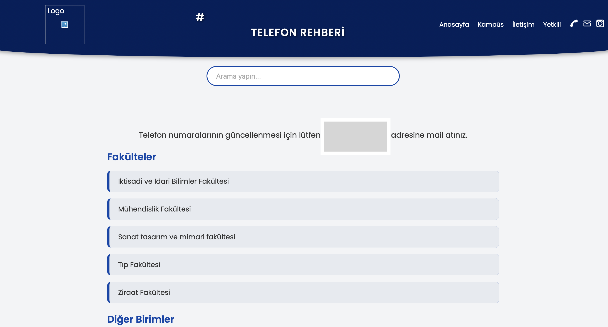
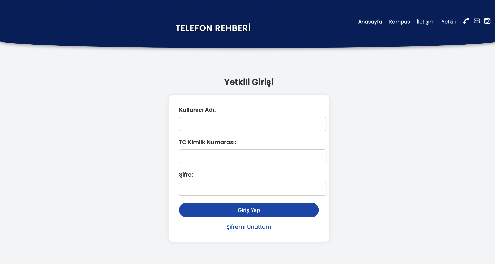

# Kurumsal Telefon Rehberi

Bir üniversitenin akademik ve idari personeline fakülte, bölüm ve birim bazında ulaşmayı sağlayan web tabanlı telefon rehberi. Ziyaretçiler rehberde arama yapabilir. Yetkililer ise giriş yaparak kişi, bölüm ve birim ekleyip düzenleyebilir.

> Bir üniversitenin Dijital Dönüşüm Ofisi'ndeki çalışmam sırasında (2025) PHP ve MySQL ile geliştirdim.

  
  &nbsp;
  

## Özellikler

- **Hiyerarşik rehber:** Fakülte → bölüm → personel; rektörlük ve daire başkanlığı gibi birimler için iç içe (alt birimli) yapı
- **Arama:** Rehberde anlık arama
- **Personel kartları:** Unvan, ad soyad, telefon, e-posta ve profil fotoğrafı
- **Yetkili paneli:** Kişi ekleme, güncelleme, silme; yeni fakülte, bölüm ve birim tanımlama
- **Dinamik form:** Fakülte seçilince bölüm listesi AJAX ile yüklenir

## Güvenlik

| Risk | Önlem |
| --- | --- |
| SQL injection | Tüm sorgular `prepare()` + `bind_param()` ile çalışır; kullanıcı verisi SQL metnine eklenmez |
| Yetkisiz erişim | Yetkili sayfaları ve işlemler (`auth.php`) oturum kontrolü olmadan açılmaz |
| Şifre sızıntısı | Şifreler `password_hash` (bcrypt) ile saklanır, `password_verify` ile doğrulanır |
| Oturum sabitleme | Başarılı girişte `session_regenerate_id()` ile oturum yenilenir |
| XSS | Veritabanından gelen metinler `htmlspecialchars` ile ekrana basılır |
| Zararlı dosya yükleme | Yalnızca resim dosyaları kabul edilir, dosyalar rastgele adla kaydedilir, `uploads/` klasöründe script çalıştırma kapalıdır |

## Veritabanı

`telefon_rehberi.sql` dosyası şemayı ve **örnek** verileri içerir. Personel kayıtları uydurmadır ("Örnek Personel 1" gibi).

| Tablo | İçerik |
| --- | --- |
| `fakulteler` | Fakülteler |
| `bolumler` | Bölümler (`fakulte_id` ile fakülteye bağlı) |
| `birimler` | İdari birimler (`ust_birim_id` ile iç içe yapı) |
| `kisiler` | Personel (bir bölüme ya da birime bağlı) |
| `kullanicilar` | Yetkili hesapları |

## Kurulum

1. [XAMPP](https://www.apachefriends.org/) kurun, Apache ve MySQL'i başlatın.
2. Proje klasörünü `htdocs/telefon-rehberi` altına kopyalayın.
3. phpMyAdmin'de `telefon_rehberi` adında bir veritabanı oluşturup `telefon_rehberi.sql` dosyasını içe aktarın.
4. Gerekirse `db.php` dosyasındaki bağlantı bilgilerini düzenleyin.
5. `http://localhost/telefon-rehberi/anasayfa.php` adresini açın.

**Demo yetkili girişi:** kullanıcı adı `admin` · TC `12345678901` · şifre `demo1234`

## Dosya Yapısı

| Dosya | Görevi |
| --- | --- |
| `anasayfa.php` | Rehber ana sayfası: fakülteler ve birimler |
| `fakulte.php` | Seçilen fakültenin bölümleri ve personeli |
| `get_bolumler.php` | Fakülteye göre bölüm listesi (AJAX) |
| `iletisim.php` | İletişim sayfası |
| `yetkili.php` | Yetkili girişi |
| `auth.php` | Yetkili oturum kontrolü |
| `yetkilisayfa.php` | Yetkili paneli |
| `process.php` | Ekleme, güncelleme ve silme işlemleri |
| `db.php` | Veritabanı bağlantısı |

**Teknolojiler:** PHP 8, MySQL/MariaDB, HTML, CSS, JavaScript

## Geliştirici

**Emine Yaren Almas** · [GitHub](https://github.com/yarenalms) · [LinkedIn](https://www.linkedin.com/in/yaren-almas-4280a3233) · [curtstudio.netlify.app](https://curtstudio.netlify.app)
